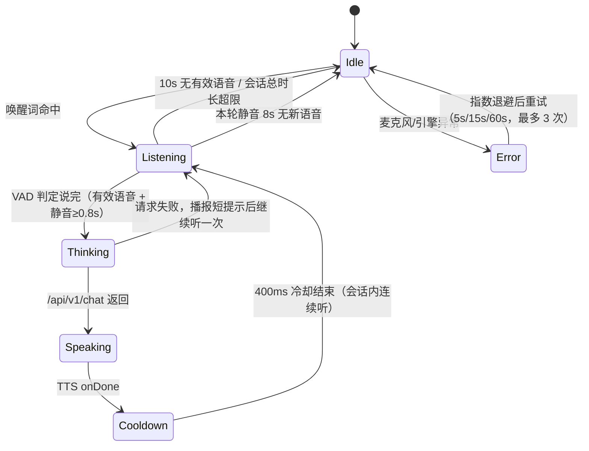

# 免按键语音交互：唤醒词与会话状态机设计

> 状态：设计稿（2026-11-11），**未实现、未改代码**。
> 目标：老人不按任何按钮，喊唤醒词 → 连续对话 → 播报完自动继续听 → 静音一段时间回到待唤醒。
> 本文中的模型体积、阈值、库版本均为**待真机验证**的初始值，不是已验证结论。

## 0. 一句话结论

用 **sherpa-onnx KWS**（Apache-2.0、完全离线、拼音自定义唤醒词、模型十几 MB）做唤醒；唤醒后切到**本地流式 ASR + VAD** 做会话；TTS 期间**关闭麦克风并留冷却时间**，播报结束自动重开一轮；所有音频不出设备，只把识别文本发给现有 `/api/v1/chat`。**最大风险不是唤醒词，而是老人（方言/口齿/远场）的 ASR 识别率**，以及电视/家人说话造成的误唤醒。

---

## 1. 唤醒词方案选型

### 1.1 对比

| 方案 | 中文唤醒 | 自定义唤醒词 | 离线 | 授权 / 费用 | 体积（待实测） | 结论 |
| --- | --- | --- | --- | --- | --- | --- |
| **sherpa-onnx KWS** | 有：`sherpa-onnx-kws-zipformer-wenetspeech-3.3M-2024-01-01`（中文）、`sherpa-onnx-kws-zipformer-zh-en-3M-2025-12-20`（中英） | **支持**，改 `keywords.txt` 即可，无需重新训练；拼音 token 序列 + `@显示文本` | 是 | **Apache-2.0，免费，无 key** | 参数 3.3M / 3M，文件约十几 MB 量级（**待实测**） | **推荐** |
| Picovoice Porcupine | 官方支持 Chinese (Mandarin) | 支持，Console 输入词语即生成模型 | 推理离线，但初始化要 AccessKey（是否需联网校验**待验证**） | 免费档 1 MAU；Foundation **$6,000/年（100 MAU）**；商用需授权 | 单关键词模型通常 ~1 MB 量级（**待实测**） | 备选，成本与 key 管理不划算 |
| Vosk | 有中文小模型 `vosk-model-small-cn-0.22` | 无专门 KWS；靠**限定词表/grammar** 做近似关键词检测 | 是 | Apache-2.0，免费 | **42 MB** | 不推荐做常驻唤醒：功耗与误报都偏高 |
| HMS / 系统能力 | HarmonyOS 4 / HMS Android **没有公开的第三方唤醒词 API**；Core Speech Kit 的 FAQ 给的做法是「应用在前台开录音 + 流式识别 + 在 `onResult` 里校验唤醒词」，本质仍是全量 ASR | 不支持真正 KWS | — | — | — | **不作为方案**；且它要求应用已在前台，解决不了常驻监听 |
| 华为「小艺」语音唤醒 | 系统级，属于华为自家助手 | 不对第三方开放 | — | — | — | 不可用（未找到开放接口） |

> 标注：Porcupine 的价格取自官网 pricing 页（Free / Foundation $6k/年 / Enterprise $30k/年），具体额度以购买页为准；「推理离线但初始化需 AccessKey」是常见集成方式，是否需要周期性联网校验请以官方文档/实测为准。

### 1.2 推荐与唤醒词建议

**推荐 sherpa-onnx KWS**，理由：

1. 完全离线、无账号无 key，符合「音频不出设备」；
2. 自定义唤醒词只改一个文本文件，换词不需要重新训练；
3. 官方提供 Android APK demo，能先用现成 demo 在真机上判断可行性，再决定是否集成；
4. Apache-2.0，家里自用没有授权风险。

**唤醒词候选**（中文两字词误唤醒率会明显更高，建议默认用四字）：

| 候选 | 音节数 | 评价 |
| --- | --- | --- |
| 小逸 | 2 | 老人顺口，但短、易被电视/聊天误触发 |
| **小逸小逸** | 4 | **已选定为默认**；与小艺同音，必须按 §1.4 关闭系统语音唤醒 |
| 小安小安 | 4 | **备选**，误唤醒严重时替换 |
| 小暖小暖 | 4 | **备选**，语义更贴陪伴场景 |

> 换词只改关键词配置（拼音 token + `@显示文本`），不需要改代码或重新训练模型。

「奶奶 / 爷爷」仍然不要用，日常对话里出现频率太高。

最终词需要老人自己试读：语速慢、吐字不清时，两字词可能反而更难稳定命中。

### 1.3 集成方式（待实现）

- 依赖 Android 版 sherpa-onnx（JNI/ONNX Runtime），模型放 `assets/` 或首次启动解压到应用私有目录。
- 麦克风 16 kHz、单声道、16-bit；按 100 ms 左右分块送入 KWS。
- 关键词文件示例（格式来自官方文档/社区实践，**需以所选模型自带 `keywords.txt` 为准**）：

  ```
  x iǎo y ì x iǎo y ì @小逸小逸
  ```

  拼音 token 写法必须和模型 `tokens.txt` 对齐，建议用官方的 `sherpa-onnx-cli text2token` 生成，不要手写。
- 需要调的两个参数：关键词阈值（类似 `:1.5`）与尾随空白惩罚（类似 `#0.35`），先用模型默认值，真机再调。

### 1.4 设备侧必须关闭小艺语音唤醒

「小逸小逸」与华为助手的「小艺小艺」同音，两个唤醒引擎会互相抢占：我们喊不醒自己的应用，或者小艺被反复叫出来。到货后、安装应用前必须做：

1. 打开 **设置 → 智慧助手（或「小艺」）→ 语音唤醒**；
2. 关闭语音唤醒总开关（不同 HarmonyOS 版本的菜单名可能是「语音唤醒」「小艺语音唤醒」「熄屏语音唤醒」，以设备实际为准）；
3. 顺便检查「电源键长按唤起」「耳机线控唤起」等入口，按需关闭；
4. 在应用内做一次验证：连续喊 10 次「小逸小逸」，确认只触发我们的应用、不出现小艺的应答。

**系统更新后该设置可能被重置**，每次系统升级后要复查一次。建议在应用的自检页（`/diagnose`）加一条提示文案，并在首次启动时引导家属完成设置。

如果老人已经习惯用「小艺」打电话/听戏，也可以反过来：保留小艺、把我们的唤醒词换成「小安小安」或「小暖小暖」，只需改关键词配置。

---

## 2. 会话状态机

### 2.1 状态图



### 2.2 状态表

| 状态 | 麦克风 | 界面提示 | 进入条件 | 离开条件 |
| --- | --- | --- | --- | --- |
| **Idle 待唤醒** | 开，仅跑 KWS | 顶部状态点：「在等您叫我」 | 启动/会话超时/出错恢复 | KWS 命中 → Listening |
| **Listening 会话中** | 开，跑 VAD + 流式 ASR | 「我在听」+ 声波动画 | 唤醒命中；或上一轮播报结束 | 说完（见 §3）→ Thinking；静音 8–10s → Idle；超过单轮上限 → 按说完处理 |
| **Thinking 等回答** | **关**（避免把环境音当下一句） | 「我想想」 | 文本已上屏并发给后端 | 收到回复 → Speaking；超时/失败 → 短提示 + Listening 一次 |
| **Speaking 播报中** | **关**（关键：防自激） | 「我在说」+ 可点停止 | 回复文本到达 | TTS `onDone` → Cooldown；用户点停止也 → Cooldown |
| **Cooldown 冷却** | 关 | 同上 | 播报结束 | 400 ms 后 → Listening |
| **Idle 回退** | 开 KWS | 「在等您叫我」 | 静音超时 / 用户退出 | — |
| **Error** | 关 | 「麦克风出问题了」 | 权限/引擎/服务异常 | 退避重试成功 → Idle |

### 2.3 关键决策

**播报时麦克风是否继续听？**
**第一阶段不继续听。** 原因：

1. 平板扬声器与麦克风在同一机身，TTS 声音会被直接收进来；
2. 即使有 AEC（`AcousticEchoCanceler`），老人设备距离 0.5–1.5 m，残余回声仍可能被 ASR/KWS 当成语音；
3. 打断（barge-in）是后续需求，先保证「不自己跟自己说话」。

因此：`Speaking` 与 `Cooldown` 期间**停止喂音频**，只在 `Listening` 和 `Idle` 开麦。

**怎么避免播报结束立刻把自己最后一句收进去？**

- TTS 的 `onDone` 回调之后再加 **300–500 ms 冷却**，等扬声器余音衰减；
- 冷却结束后，先丢弃前 200 ms 音频（或要求 VAD 连续 300 ms 判为语音才开始计分）；
- 会话中第一轮重新开麦时，**不做 KWS 检测**，直接进 ASR，避免 TTS 尾音触发唤醒；
- 真机上若仍有自激，再打开 `AudioManager.MODE_IN_COMMUNICATION` + AEC/NS，或把冷却加到 800 ms。

**会话边界**：唤醒一次算一个「会话」，会话内可以多轮；连续 8 秒没有有效语音就结束会话、回到 KWS。会话总时长设上限（如 5 分钟），防止电视一直说话导致永不退出。

---

## 3. VAD / 断句策略

目标：老人说话慢、有停顿，**不能一停顿就送走**。

1. **VAD**：优先用 sherpa-onnx 自带的 Silero VAD（`silero_vad.onnx`），比能量阈值抗噪；没有把握时先用能量 + 过零率做原型。
2. **开始条件**：连续 300 ms 判为语音才进入「正在说话」，避免咳嗽、关门声触发。
3. **结束条件**：**连续 800 ms 静音**才算说完（初始值；老人停顿长可调到 1200 ms）。
4. **最短有效语音**：300 ms。低于此长度且识别为空 → 丢弃，不发送，继续等（避免「嗯」被当成一句）。
5. **最长单句**：15 秒强制断句送识别，防止有人一直说导致永远不结束。
6. **二次确认**：静音 800 ms 后先拿到 ASR 的最终结果，再等 200 ms；若这 200 ms 内又出现语音，则把这段拼回同一句（简单版可先不做）。
7. **静音回退**：进入 `Listening` 后 8–10 秒仍无有效语音 → 结束会话回 `Idle`。

以上全部是**初始值**，必须在真机上用老人真实语速标定。

### 3.1 ASR 选择（唤醒之后）

| 选项 | 说明 | 取舍 |
| --- | --- | --- |
| **sherpa-onnx 流式中文 ASR**（推荐先试） | 与 KWS 同一运行时，离线，可拿到 partial/final | 模型更大（**体积待实测**），CPU 占用高于 KWS |
| HMS ML Kit 流式 ASR | 识别效果好，需 AGC + 网络 | 音频要出设备，与隐私目标冲突；且引入 AGCP 依赖 |
| 系统 `RecognizerIntent` | 现在已接 | **不适合**免按键：会弹系统界面、不能连续流式、无法自动重开 |

结论：免按键形态下，`RecognizerIntent` 只能保留为按钮降级路径；连续会话需要嵌入式流式 ASR。**若真机 ASR 识别率不可接受，再评估云端 ASR（此时要接受音频出设备）。**

---

## 4. 工程约束

### 4.1 前台服务与麦克风

- 需要 `FOREGROUND_SERVICE` + `FOREGROUND_SERVICE_MICROPHONE`（Android 14 / API 34 起）+ `RECORD_AUDIO` + `POST_NOTIFICATIONS`（13+）。
- **Android 14 的关键限制**：`microphone` 类型的前台服务**不能在应用处于后台时创建**，也**不能从 `BOOT_COMPLETED` 直接启动**。因此：
  - 常驻监听的正确姿势是：Activity 在前台（kiosk 常亮）时启动前台服务；
  - 开机自启只负责把 Activity 拉起来（现有 `BootReceiver`），**不要**在 Receiver 里直接起麦克风前台服务；
  - 当前 `targetSdk = 33`，升级到 34 时这条会立刻生效，必须按上面改。
- 华为/鸿蒙 4 的「应用启动管理」可能拦截自启与后台保活，需要手动允许；这是设备侧设置，不是代码能保证的。

### 4.2 常驻通知

- 一条低优先级常驻通知：「陪伴助手 · 在等您叫我」；会话中变为「正在听」；提供「暂停监听」按钮（家属用）。
- 通知不能太吵：无声、不可清除（前台服务要求），但**不要**每秒刷新。

### 4.3 耗电与发热

- 常驻 KWS 是持续推理，虽然模型小，但 24 小时跑仍需实测电流；
- 建议策略：屏幕熄灭 / Activity 不可见时暂停 KWS；充电时正常；低电量（<15%）自动降级为按钮模式；
- 真机至少测：待唤醒 1 小时耗电百分比、会话 10 分钟机身温度。

### 4.4 误唤醒

- 默认四字词；两字词只在老人坚持时用；
- 记录每次唤醒的音频特征/触发时间（**不存原始音频**，只存时间戳与置信度），便于事后调阈值；
- 连续误唤醒 3 次（10 分钟内无后续有效语音）→ 自动提高阈值并提示家属。

### 4.5 隐私

- KWS、VAD、ASR 全部本地；**原始音频不落盘、不上传、不缓存**；
- 只把 ASR 文本发给现有 `/api/v1/chat`；后端已有脱敏与审计；
- 界面上有明确指示：麦克风开启时常亮小圆点/「正在听」；
- 家属可一键暂停监听（通知按钮 + 设置页）。

### 4.6 与现有 `Shell` 桥契约的扩展

保持已实现的方法不变（`startListening` / `stopListening` / `speak` / `stopSpeaking` / `callNumber`），**新增**：

| 类型 | 名称 | 说明 |
| --- | --- | --- |
| 方法 | `startVoiceSession(): boolean` | 启动常驻监听（Activity 在前台才允许） |
| 方法 | `stopVoiceSession(): void` | 停止监听，回按钮模式 |
| 方法 | `voiceSessionRunning(): boolean` | 当前是否常驻监听 |
| 回调 | `onShellVoiceState(state: string)` | `idle` / `wake` / `listening` / `thinking` / `speaking` / `error` |
| 回调 | `onShellVoiceInput(text: string)` | 一轮识别完成，交给网页发 `/chat` |
| 回调 | `onShellVoiceLevel(level: number)` | 0–1 音量，用于「我在听」动画（可选） |

状态归属要明确，避免两端各有一套状态机：

- **原生负责音频相关状态**：`idle → wake → listening → speaking → idle`；
- **网页负责网络相关状态**：收到 `onShellVoiceInput` 后进入 `thinking`，调用 `/chat`，拿到回复调 `speak`；
- 原生在 `speaking` 结束后自动回到 `listening`，**不需要网页再触发**；
- 网页只做展示与「暂停/恢复」按钮，不判断平台。

前端展示建议：对话页顶部一个状态条（大字）：「在等您叫我 / 我在听 / 我想想 / 我在说」，配不同底色；按钮流程保留为降级入口。

---

## 5. 降级路径

按顺序降级，任何一层失败都不影响「能用」：

1. **KWS 引擎初始化失败**（模型缺失、ABI 不支持、内存不足）→ 关闭常驻监听，保留现有按钮流程（`startListening` + 系统识别）。
2. **KWS 可用但该机型误唤醒过高** → 换四字词 / 提高阈值；仍不行则由家属在设置里关闭常驻监听。
3. **流式 ASR 不可用** → 会话内退回「按钮 + 系统识别」，播报仍自动。
4. **麦克风权限被拒 / 前台服务被系统杀** → 顶部提示「语音已暂停，点一下话筒继续」。
5. **低电量 / 息屏** → 暂停 KWS，亮屏后自动恢复。

降级的判定与提示都由原生侧完成，网页只接收 `onShellVoiceState('error')` 展示。

---

## 6. 分阶段落地（先真机验证，再接 LLM）

| 阶段 | 做什么 | 验证什么 | 是否动前端 |
| --- | --- | --- | --- |
| **P0 唤醒闭环** | 集成 sherpa-onnx KWS，只做「命中 → 响一声提示音 → 打印日志」，不接 ASR/LLM | 1–3 m 距离、正常电视音量下的唤醒率与误唤醒次数；1 小时耗电 | 否 |
| **P1 唤醒 → 识别** | KWS 命中后切流式 ASR + VAD，识别文本打到日志/界面 | 老人真实语速下断句是否合理；「说一半被送走」的比例 | 少量（只显示文本） |
| **P2 完整闭环** | 识别文本 → `/api/v1/chat` → TTS 播报 → 自动继续听 → 静音回待唤醒 | 连续 3 轮对话不中断、不自己触发自己；失败提示是否听得懂 | 是 |
| **P3 打磨** | 阈值标定、通知、隐私开关、低电量降级、误唤醒统计 | 连续运行 24 小时稳定性 | 是 |
| **P4 可选** | 打断（barge-in）、方言/口音优化、离线 LLM | — | 视需要 |

**最快能验证的一步是 P0**：不改前端、不接后端，只验证「这台平板能不能稳定听到小逸小逸」（先关闭小艺语音唤醒）。如果 P0 的误唤醒/唤醒率不达标，先换「小安小安」/「小暖小暖」再测；仍不行就直接退回按钮方案。

---

## 7. 不确定 / 待验证清单

1. **sherpa-onnx KWS 模型确切体积与 Android ABI 支持**：官方 release 包大小、arm64 运行时体积需实测。
2. **关键词拼音 token 与所选模型 `tokens.txt` 的对应关系**：必须用 `text2token` 生成，手写容易错。
3. **唤醒阈值/尾随空白惩罚的合适取值**：不同房间噪声差异很大，只能真机调。
4. **VAD 阈值与静音时长**：800 ms 是起点，老人实际语速可能要到 1200 ms。
5. **流式 ASR 选型与体积**：sherpa-onnx 中文流式模型的具体型号/大小未定；HMS 流式 ASR 需要 AGC 且音频出设备。
6. **Porcupine 的 AccessKey 是否需周期性联网校验、免费档是否允许自用分发**：以官网/实测为准。
7. **Android 14 前台服务限制在 HarmonyOS 4 平板上的实际表现**：设备 API 级别与华为定制策略需真机确认。
8. **当前平板长时间常驻 KWS 的功耗与发热**：完全未知，必须先测。
9. **老人方言/口齿下的 ASR 识别率**：这是产品成败的最大变量，不是工程变量。

---

## 8. 参考来源

- sherpa-onnx 关键词检测总览与关键词文件格式：<https://k2-fsa.github.io/sherpa/onnx/kws/>
- sherpa-onnx KWS 预训练模型（中文 wenetspeech 3.3M / 中英 3M，含自定义关键词步骤）：<https://k2-fsa.github.io/sherpa/onnx/kws/pretrained_models/index.html>
- sherpa-onnx KWS Android APK 列表：<https://k2-fsa.github.io/sherpa/onnx/kws/apk-cn.html>
- sherpa-onnx VAD 模型（silero_vad.onnx）：<https://k2-fsa.github.io/sherpa/onnx/pretrained_models/>
- Picovoice Porcupine 支持语言（含中文）：<https://picovoice.ai/platform/porcupine/>
- Picovoice 定价（Free / Foundation / Enterprise）：<https://picovoice.ai/pricing/>
- Picovoice AccessKey 说明：<https://picovoice.ai/docs/porcupine/>
- Vosk 模型列表（`vosk-model-small-cn-0.22`，42 MB，Apache-2.0）：<https://alphacephei.com/vosk/models>
- Vosk Android 说明：<https://alphacephei.com/vosk/android>
- HarmonyOS Core Speech Kit 简介：<https://developer.huawei.com/consumer/cn/doc/harmonyos-guides/core-speech-introduction>
- HarmonyOS FAQ：用流式识别 + `onResult` 校验实现「唤醒词拉起应用内助手」：<https://developer.huawei.com/consumer/cn/doc/harmonyos-faqs/faqs-core-speech-4>
- Android 前台服务类型（microphone）与 while-in-use 限制：<https://developer.android.google.cn/develop/background-work/services/fgs/service-types>
- Android 后台启动前台服务限制（含 BOOT_COMPLETED）：<https://developer.android.google.cn/develop/background-work/services/fgs/restrictions-bg-start>
